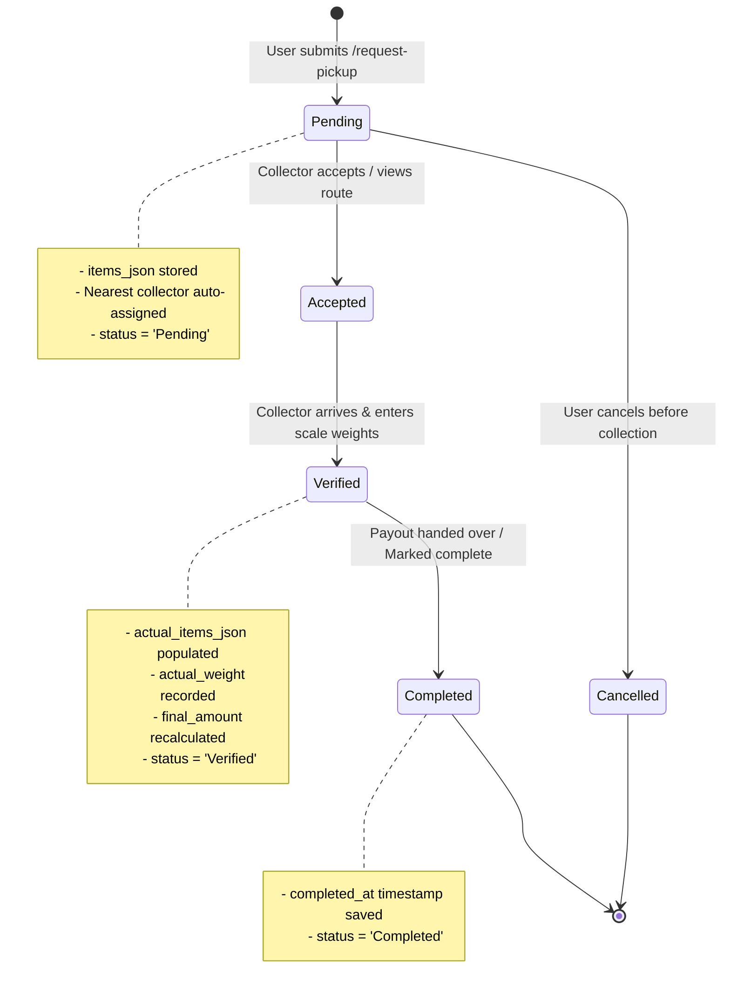

# SmartScrapCollection (WasteTech / Aakri) - Master Project Specification & AI Architecture Guide

> **AI System Prompt**: This document provides the exhaustive, end-to-end technical specification, schema, algorithmic models, API routing directory, and operational architecture of the **SmartScrapCollection (WasteTech)** codebase. Any AI assistant analyzing or modifying this repository must use this document as the single source of truth.

---

## 1. Project Identity & Domain Overview

- **Project Title:** SmartScrapCollection (Branded as **WasteTech** / Database moniker: `aakri_db`)
- **Domain:** On-Demand Doorstep Recyclable Scrap Collection & Circular Economy Platform
- **Problem Solved:** Traditional scrap selling suffers from opaque pricing, inconvenient doorstep pickup scheduling, inefficient collector routes, and lack of accountability. SmartScrapCollection digitizes the entire supply chain from scrap generation to localized collector dispatch and administrative oversight.
- **Key Capabilities:**
  1. **Dynamic Commodity-Indexed Pricing:** Fetches live market commodity futures (Copper, Aluminium, Steel) and real-time USD/INR foreign exchange rates to update scrap rates automatically every day.
  2. **Automated Nearest-Collector Dispatch:** Employs the Haversine great-circle formula to calculate geodesic distances and automatically assign pickup bookings to the nearest available collector.
  3. **Collector Route Optimization (TSP):** Solves the Traveling Salesperson Problem (TSP) using a greedy Nearest Neighbor heuristic to sequence daily pickup stops starting from the collector's current coordinates, minimizing transit time and fuel expenditure.
  4. **Multi-Role Portal (RBAC):** Dedicated interfaces for Customers, Scrap Collectors, and System Administrators.
  5. **Two-Factor Onboarding via Email OTP:** Cryptographic 6-digit one-time password system with 15-minute expiration dispatched over secure TLS SMTP.
  6. **On-Site Weight Verification & Payout Adjustment:** On-site modal where collectors input actual scale weights, dynamically recalculating the final payout.

---

## 2. Technology Stack & Dependencies

| Component | Technology | Version / Details |
| :--- | :--- | :--- |
| **Backend Runtime** | Python | 3.10+ |
| **Web Framework** | Flask | >= 2.3 |
| **Database Driver** | MySQL Connector Python | >= 8.0 (`mysql-connector-python`) |
| **Environment Loader** | python-dotenv | >= 1.0 (with custom fallback loader) |
| **Password Security** | Werkzeug | `generate_password_hash`, `check_password_hash` (PBKDF2 SHA-256) |
| **Template Engine** | Jinja2 | HTML5 Server-Side Rendering |
| **Styling & UI** | Custom CSS (`static/style.css`) | Responsive CSS3 variables, flexbox, CSS grid, dark & light themes |
| **Icons** | FontAwesome CDN | FontAwesome 6.5.1 |
| **Mapping & GIS** | Leaflet.js CDN | Leaflet 1.9.4 for map rendering and route polylines |
| **Geolocation** | HTML5 Geolocation API | High accuracy fallback to IPAPI (`https://ipapi.co/json/`) |
| **Market Data APIs** | Yahoo Finance & Open ER-API | Yahoo Finance v8 chart API & Open ER-API v6 |
| **Email Protocol** | Python `smtplib` / `EmailMessage` | Port 587 STARTTLS (Gmail App Password support) |

---

## 3. Complete File & Directory Map

```text
SmartScrapCollection/
│
├── app.py                      # Master application entrypoint (~2,000 lines). Contains:
│                               # - App config & initialization
│                               # - Database auto-migration & seed data (ensure_tables_exist)
│                               # - Mathematical algorithms (Haversine, TSP route optimization)
│                               # - Validation, session handlers, email OTP dispatching
│                               # - 29 Flask route endpoints across 3 user roles
│
├── config.py                   # Configuration class with dual-mode .env parser (python-dotenv + raw parser)
│
├── market_api.py               # Real-time scrap price computation engine:
│                               # - Fetches USD/INR FX rates from Open ER-API
│                               # - Fetches LME futures quotes from Yahoo Finance
│                               # - Converts commodity futures to local INR scrap scrap prices
│                               # - Calculates day-over-day % change and trend ('up'|'down'|'stable')
│
├── cron_update_prices.py       # Standalone scheduled script to sync daily market prices into MySQL
│
├── requirements.txt            # Python requirements (Flask, mysql-connector-python, python-dotenv)
│
├── .env                        # Local active configuration (credentials, secrets, DB settings)
├── .env.example                # Template configuration file for development onboarding
├── PROJECT_DETAILS.md          # Complete project architecture & context specification
│
├── static/
│   └── style.css               # Unified stylesheets (Navbar, Cards, Modals, Forms, Buttons, Dashboard)
│
└── templates/                  # Jinja2 HTML5 UI Templates
    ├── index.html              # Homepage with scrap price ticker, service features & booking CTA
    ├── scrap_prices.html       # Daily live scrap rate card with category filtering & % changes
    ├── request_pickup.html     # Interactive pickup scheduling form with multi-item calculator & GPS
    ├── my_pickups.html         # User pickup tracker, cancel requests, and feedback/complaints modal
    ├── profile.html            # User profile management and saved geolocation
    │
    ├── login.html              # Customer authentication login form
    ├── register.html           # Customer registration form
    ├── verify.html             # Customer 6-digit email OTP verification form
    │
    ├── collector_login.html    # Collector portal login form
    ├── collector_register.html # Collector onboarding form
    ├── collector_verify.html   # Collector email OTP verification form
    ├── collector_dashboard.html# Collector operations center:
    │                           # - Availability switch (Online/Offline)
    │                           # - Interactive Leaflet route map
    │                           # - TSP-ordered pickup stops
    │                           # - On-site weight & item verification modal
    │
    ├── admin_login.html        # System administrator login
    └── admin_dashboard.html    # Master admin panel:
                                # - Real-time KPI summary (Users, Collectors, Volume, Payouts)
                                # - Pickup requests audit table
                                # - User management (status toggle, delete)
                                # - Collector approvals & moderation
                                # - Customer complaints & ratings resolution
```

---

## 4. Comprehensive Database Schema (`aakri_db`)

The database self-heals and auto-migrates via `ensure_tables_exist()` in [app.py](file:///C:/Users/Preejith%20Prasad/.gemini/antigravity/scratch/SmartScrapCollection/app.py).

### 4.1 Table: `users`
Stores registered customer accounts.
```sql
CREATE TABLE IF NOT EXISTS users (
    id INT PRIMARY KEY AUTO_INCREMENT,
    username VARCHAR(255),
    email VARCHAR(255),
    password VARCHAR(255),
    phone VARCHAR(50),
    address TEXT,
    latitude DECIMAL(10, 8) DEFAULT 12.9716,
    longitude DECIMAL(11, 8) DEFAULT 77.5946,
    location_label VARCHAR(50) DEFAULT 'Home',
    city VARCHAR(100) DEFAULT 'Bengaluru',
    pincode VARCHAR(20) DEFAULT '560001',
    account_status VARCHAR(50) DEFAULT 'Active', -- 'Active', 'Suspended'
    is_verified TINYINT DEFAULT 0,               -- 0 = pending OTP, 1 = verified
    otp_code VARCHAR(10),                        -- 6-digit cryptographic OTP
    otp_expires DATETIME,                        -- Expiry timestamp (NOW + 15 mins)
    created_at TIMESTAMP DEFAULT CURRENT_TIMESTAMP
);
```

### 4.2 Table: `collectors`
Stores scrap collector partners and their operational parameters.
```sql
CREATE TABLE IF NOT EXISTS collectors (
    id INT PRIMARY KEY AUTO_INCREMENT,
    username VARCHAR(255),
    email VARCHAR(255),
    phone VARCHAR(50),
    password VARCHAR(255),
    address TEXT,
    latitude DECIMAL(10, 8) DEFAULT 12.9716,
    longitude DECIMAL(11, 8) DEFAULT 77.5946,
    availability_status TINYINT DEFAULT 1,       -- 1 = Online/Available, 0 = Offline/Busy
    approval_status VARCHAR(50) DEFAULT 'Approved', -- 'Approved', 'Pending', 'Rejected'
    account_status VARCHAR(50) DEFAULT 'Active', -- 'Active', 'Suspended'
    is_verified TINYINT DEFAULT 0,
    otp_code VARCHAR(10),
    otp_expires DATETIME,
    created_at TIMESTAMP DEFAULT CURRENT_TIMESTAMP
);
```

### 4.3 Table: `admins`
Stores system administrator credentials.
```sql
CREATE TABLE IF NOT EXISTS admins (
    id INT PRIMARY KEY AUTO_INCREMENT,
    username VARCHAR(255),
    email VARCHAR(255),
    password VARCHAR(255),
    created_at TIMESTAMP DEFAULT CURRENT_TIMESTAMP
);
```
*Default Seed Account on first boot:*
- `username`: `System Admin`
- `email`: `admin@wastetech.com`
- `password`: `Admin@123` (hashed with PBKDF2)

### 4.4 Table: `pickup_requests`
Primary transactional table tracking each scrap pickup lifecycle.
```sql
CREATE TABLE IF NOT EXISTS pickup_requests (
    id INT PRIMARY KEY AUTO_INCREMENT,
    user_id INT,
    user_name VARCHAR(255),
    collector_id INT NULL,                      -- References collectors(id)
    scrap_type VARCHAR(255),                    -- Human readable summary (e.g. "Paper, Metals")
    estimated_weight DECIMAL(10, 2) DEFAULT 0.0,-- User-submitted estimated weight in kg
    actual_weight DECIMAL(10, 2) DEFAULT 0.0,   -- Collector-verified physical weight in kg
    items_json TEXT,                            -- Serialized JSON array of booked items
    actual_items_json TEXT,                     -- Serialized JSON array of verified items & weights
    total_price DECIMAL(10, 2) DEFAULT 0.0,     -- Initial estimated payout (INR)
    final_amount DECIMAL(10, 2) DEFAULT 0.0,    -- Verified final payout (INR)
    pickup_date DATE,                           -- Scheduled pickup date
    time_slot VARCHAR(100),                     -- e.g. "Morning (09:00 AM - 12:00 PM)"
    phone VARCHAR(50),
    address TEXT,
    latitude DECIMAL(10, 8) DEFAULT 12.9716,
    longitude DECIMAL(11, 8) DEFAULT 77.5946,
    distance_km DECIMAL(10, 2) DEFAULT 0.0,     -- Geodesic distance from assigned collector
    notes TEXT,
    status VARCHAR(50) DEFAULT 'Pending',       -- 'Pending', 'Accepted', 'Verified', 'Completed', 'Cancelled'
    completed_at DATETIME NULL,
    created_at TIMESTAMP DEFAULT CURRENT_TIMESTAMP
);
```

### 4.5 Table: `scrap_rates`
Daily historical and current market scrap prices.
```sql
CREATE TABLE IF NOT EXISTS scrap_rates (
    id INT PRIMARY KEY AUTO_INCREMENT,
    category VARCHAR(100),                      -- 'Paper', 'Plastic', 'Metals', 'E-Waste', 'Vehicle'
    item_code VARCHAR(100),                     -- Unique slug (e.g. 'metal_copper')
    item_name VARCHAR(255),                     -- Display name (e.g. 'Copper Wires / Scrap')
    rate_per_unit DECIMAL(10, 2),               -- Price in INR
    unit VARCHAR(50),                           -- 'kg' or 'unit'
    rate_date DATE,                             -- Date of rate
    trend VARCHAR(20) DEFAULT 'stable',         -- 'up', 'down', 'stable'
    change_percent DECIMAL(5, 2) DEFAULT 0.0,   -- Daily percentage difference
    created_at TIMESTAMP DEFAULT CURRENT_TIMESTAMP,
    UNIQUE KEY unique_item_date (item_code, rate_date)
);
```

### 4.6 Table: `feedback_complaints`
Customer reviews, star ratings, and formal service tickets.
```sql
CREATE TABLE IF NOT EXISTS feedback_complaints (
    id INT PRIMARY KEY AUTO_INCREMENT,
    user_id INT,
    user_name VARCHAR(255),
    collector_id INT NULL,
    pickup_id INT NULL,
    type VARCHAR(50) DEFAULT 'Feedback',        -- 'Feedback' or 'Complaint'
    subject VARCHAR(255),
    message TEXT,
    rating INT DEFAULT 5,                       -- Integer 1 to 5
    status VARCHAR(50) DEFAULT 'Pending',       -- 'Pending' or 'Resolved'
    created_at TIMESTAMP DEFAULT CURRENT_TIMESTAMP
);
```

---

## 5. Supported Scrap Materials (19 Baseline Items)

| Category | Item Code | Item Name | Baseline Rate | Unit | FontAwesome Icon |
| :--- | :--- | :--- | :--- | :--- | :--- |
| **Paper** | `paper_newspaper` | Newspaper | ₹16.00 | kg | `fa-newspaper` |
| **Paper** | `paper_books` | Books & Magazines | ₹14.00 | kg | `fa-book` |
| **Paper** | `paper_carton` | Carton / Cardboard | ₹12.00 | kg | `fa-box` |
| **Paper** | `paper_office` | Office White Paper | ₹15.00 | kg | `fa-file-lines` |
| **Plastic** | `plastic_pet` | PET Bottles (Water/Soda) | ₹18.00 | kg | `fa-bottle-water` |
| **Plastic** | `plastic_hard` | Hard Plastic (Buckets/Chairs) | ₹15.00 | kg | `fa-chair` |
| **Plastic** | `plastic_container` | Plastic Containers | ₹14.00 | kg | `fa-box-open` |
| **Plastic** | `plastic_poly` | Mix Plastic / Covers | ₹10.00 | kg | `fa-bag-shopping` |
| **Metals** | `metal_iron` | Iron & Steel Scrap | ₹28.00 | kg | `fa-cubes` |
| **Metals** | `metal_copper` | Copper Wires / Scrap | ₹450.00 | kg | `fa-bolt` |
| **Metals** | `metal_aluminium` | Aluminium Utensils / Scrap | ₹110.00 | kg | `fa-shield-cat` |
| **Metals** | `metal_brass` | Brass / Bronze Scrap | ₹320.00 | kg | `fa-award` |
| **E-Waste** | `ewaste_mobile` | Mobile Phones / Tablets | ₹25.00 | unit | `fa-mobile-screen` |
| **E-Waste** | `ewaste_laptop` | Laptops & Computers | ₹300.00 | unit | `fa-laptop` |
| **E-Waste** | `ewaste_tv` | TV & Monitors | ₹200.00 | unit | `fa-tv` |
| **E-Waste** | `ewaste_appliance`| Refrigerators & ACs | ₹500.00 | unit | `fa-plug` |
| **Vehicle** | `vehicle_bike` | Two Wheeler / Motorbike | ₹2,500.00 | unit | `fa-motorcycle` |
| **Vehicle** | `vehicle_car` | Four Wheeler / Car | ₹15,000.00 | unit | `fa-car` |
| **Vehicle** | `vehicle_auto` | Auto Rickshaw | ₹8,000.00 | unit | `fa-truck-monster` |

---

## 6. Algorithmic Specifications & Mathematical Models

### 6.1 Geodesic Proximity: The Haversine Distance Formula
Implemented in `haversine_distance(lat1, lon1, lat2, lon2)`:
```python
def haversine_distance(lat1, lon1, lat2, lon2):
    r = 6371.0 # Earth's radius in kilometers
    lat1, lon1, lat2, lon2 = map(math.radians, [lat1, lon1, lat2, lon2])
    dlat = lat2 - lat1
    dlon = lon2 - lon1
    a = math.sin(dlat / 2.0)**2 + math.cos(lat1) * math.cos(lat2) * math.sin(dlon / 2.0)**2
    c = 2.0 * math.atan2(math.sqrt(a), math.sqrt(1.0 - a))
    return round(c * r, 2)
```

### 6.2 Automated Nearest-Collector Matching Algorithm
Implemented in `find_nearest_collector(user_lat, user_lng)`:
1. Filter database collectors where `availability_status = 1` AND `latitude IS NOT NULL` AND `longitude IS NOT NULL`.
2. Compute `haversine_distance` between the user's location and each available collector.
3. Identify $\min(\text{distance})$.
4. Return the collector object and `distance_km`.

### 6.3 Collector Route Optimization (Traveling Salesperson Problem)
Implemented in `optimize_collector_route(collector_lat, collector_lng, pickups)`:
- Employs a Greedy Nearest Neighbor heuristic.
- Starting at $(C_{\text{lat}}, C_{\text{lng}})$, the algorithm visits the closest unvisited pickup stop, accumulates leg distance, sets the new current point, and continues until all stops are ordered.
- Computes `leg_distance_km` for each leg and aggregate `total_distance` in kilometers.
- The sequenced route is rendered visually on a Leaflet.js interactive map with polyline markers.

### 6.4 Dynamic Commodity Price Indexing (`market_api.py`)
Fetches live data and applies realistic recycling conversion factors:
- **Copper Scrap:**
  $$\text{Price}_{\text{INR/kg}} = \left(\frac{\text{Price}_{\text{USD/lb}}}{0.453592}\right) \times \text{USD\_INR} \times 0.85$$
  *(0.85 represents the scrap yield factor against pure LME grade copper wire).*
- **Aluminium Scrap:**
  $$\text{Price}_{\text{INR/kg}} = \left(\frac{\text{Price}_{\text{USD/tonne}}}{1000}\right) \times \text{USD\_INR} \times 0.65$$
  *(0.65 reflects scrap utensil/cast discount vs LME primary ingots).*
- **Steel / Iron Scrap:**
  Fluctuates relative to the VanEck Steel ETF (`SLX`) percentage change:
  $$\text{Price}_{\text{Iron}} = \text{Base}_{\text{Iron}} \times \left(1 + \frac{\Delta\%_{\text{SLX}}}{100}\right)$$
- **Brass:** Tied directly at $70\%$ of computed copper market rates.
- **Paper & Plastic Recyclables:**
  Market sentiments index shifted by:
  $$\text{Sentiment Shift} = \frac{\Delta\%_{\text{Steel}} + \Delta\%_{\text{Copper}}}{4}$$
  $$\text{Rate} = \text{Base} \times \left(1 + \frac{\text{Sentiment Shift}}{100}\right)$$
- **Trend Assignment:**
  - $\Delta\% > +0.3\% \implies \text{'up'}$
  - $\Delta\% < -0.3\% \implies \text{'down'}$
  - Otherwise $\implies \text{'stable'}$

---

## 7. Complete API & Routing Directory

| Method | Route Path | Description | Access Control |
| :--- | :--- | :--- | :--- |
| `GET` | `/` | Public landing page with price ticker & service info | Public |
| `GET` | `/api/scrap-rates` | REST API returning today's scrap prices in JSON | Public |
| `GET, POST` | `/login` | User authentication | Public |
| `GET, POST` | `/register` | User account creation & sends 6-digit OTP | Public |
| `GET, POST` | `/verify-otp` | Validates customer OTP code | Session |
| `POST` | `/resend-otp` | Generates and resends new OTP email | Session |
| `GET, POST` | `/request-pickup` | Interactive pickup form, rates calculator, & auto-dispatch | Customer Login |
| `GET` | `/scrap-prices` | Dedicated public scrap rates page with search & filters | Public |
| `GET` | `/my-pickups` | Customer history, tracking status, cancel buttons | Customer Login |
| `POST` | `/cancel-pickup/<id>` | Cancels a pending pickup request | Customer Login |
| `GET, POST` | `/profile` | Customer profile management (address, phone, coordinates) | Customer Login |
| `GET` | `/logout` | Clears user session | Customer Login |
| `GET, POST` | `/collector/login` | Collector authentication | Public |
| `GET, POST` | `/collector/register`| Collector sign-up (defaults to `approval_status='Approved'`) | Public |
| `GET, POST` | `/collector/verify-otp`| Validates collector OTP code | Collector Session |
| `POST` | `/collector/resend-otp`| Resends collector OTP email | Collector Session |
| `GET` | `/collector/dashboard`| Collector workspace, route map, TSP stops, & assignments | Collector Login |
| `POST` | `/collector/update-status`| Toggle availability (`1` or `0`) and update GPS coordinates | Collector Login |
| `POST` | `/collector/accept-pickup/<id>`| Assigns an unassigned pickup to this collector | Collector Login |
| `POST` | `/collector/verify-pickup/<id>`| Records actual weights and items from scale on-site | Collector Login |
| `POST` | `/collector/complete-pickup/<id>`| Marks pickup as `'Completed'` with `completed_at` | Collector Login |
| `GET` | `/collector/logout`| Clears collector session | Collector Login |
| `POST` | `/submit-feedback`| Submits feedback or complaint with 1-5 star rating | Customer Login |
| `GET` | `/admin` | Redirects to `/admin/dashboard` or `/admin/login` | Public |
| `GET, POST` | `/admin/login` | System administrator login | Public |
| `GET` | `/admin/dashboard`| Admin command center (KPIs, moderation, complaints) | Admin Login |
| `POST` | `/admin/user/toggle-status/<id>`| Toggles user account between `'Active'` and `'Suspended'`| Admin Login |
| `POST` | `/admin/user/delete/<id>` | Deletes user record and associated pickup requests | Admin Login |
| `POST` | `/admin/collector/approve/<id>`| Changes collector status to `'Approved'` | Admin Login |
| `POST` | `/admin/collector/toggle-status/<id>`| Toggles collector between `'Active'` and `'Suspended'` | Admin Login |
| `POST` | `/admin/complaint/resolve/<id>`| Marks user feedback/complaint ticket as `'Resolved'` | Admin Login |
| `GET` | `/admin/logout` | Clears admin session | Admin Login |

---

## 8. Pickup Lifecycle State Machine



---

## 9. Security, Authentication & Session Architecture

1. **Password Policy:**
   - Minimum 6 characters.
   - At least 1 letter, 1 number, and 1 special symbol (`[^a-zA-Z0-9]`).
   - Stored using `werkzeug.security.generate_password_hash` (PBKDF2 SHA-256).
2. **Email OTP Two-Factor Authentication:**
   - 6-digit cryptographic integer generated via `secrets.randbelow(900000) + 100000`.
   - Expires strictly after 15 minutes (`datetime.now() + timedelta(minutes=15)`).
   - Rate-limited and validated before setting `is_verified = 1`.
3. **Session Partitioning:**
   - Customer Session: `session['user_id']`, `session['username']`, `session['email']`.
   - Collector Session: `session['collector_id']`, `session['collector_name']`, `session['is_collector'] = True`.
   - Admin Session: `session['admin_id']`, `session['admin_username']`, `session['is_admin'] = True`.
4. **SQL Injection Prevention:**
   - All database queries use parameterized SQL tuples (`cur.execute(query, (val1, val2))`).

---

## 10. Setup, Execution & Testing Guide

### 10.1 Environment Configuration (`.env`)
Create or edit `.env` in the project root:
```ini
# MySQL Configuration
MYSQL_HOST=127.0.0.1
MYSQL_PORT=3306
MYSQL_USER=root
MYSQL_PASSWORD=
MYSQL_DATABASE=aakri_db

# Flask Secret Key
SECRET_KEY=dev-secret-key-replace-in-production

# SMTP Configuration for Email OTP
SMTP_HOST=smtp.gmail.com
SMTP_PORT=587
SMTP_USER=your_email@gmail.com
SMTP_PASSWORD=your_gmail_16_digit_app_password
EMAIL_FROM=your_email@gmail.com
```

### 10.2 Database Provisioning
Run in MySQL shell:
```sql
CREATE DATABASE aakri_db;
```
*(No need to run manual table scripts — `ensure_tables_exist()` in `app.py` auto-creates all 6 tables and seeds initial sample collectors and administrator accounts).*

### 10.3 Installation & Execution (Windows PowerShell)
```powershell
# Navigate to project root
cd "C:\Users\Preejith Prasad\.gemini\antigravity\scratch\SmartScrapCollection"

# Activate virtual environment
.\venv\Scripts\Activate.ps1

# Run the Flask development server
python app.py
```
*Access web interface at: `http://127.0.0.1:5000`*

### 10.4 Running Daily Price Synchronization Script
```powershell
python cron_update_prices.py
```
*Can be configured in Windows Task Scheduler or crontab to execute every night at 00:00.*

### 10.5 Default Credentials
- **Admin Panel:**
  - URL: `http://127.0.0.1:5000/admin/login`
  - Username: `admin@wastetech.com`
  - Password: `Admin@123`
- **Sample Seeded Collectors:**
  - `rahul@wastetech.com` / `Collector@123` (Indiranagar Zone)
  - `vikram@wastetech.com` / `Collector@123` (Koramangala Zone)
  - `anil@wastetech.com` / `Collector@123` (Whitefield Zone)
  - `suresh@wastetech.com` / `Collector@123` (Jayanagar Zone)
